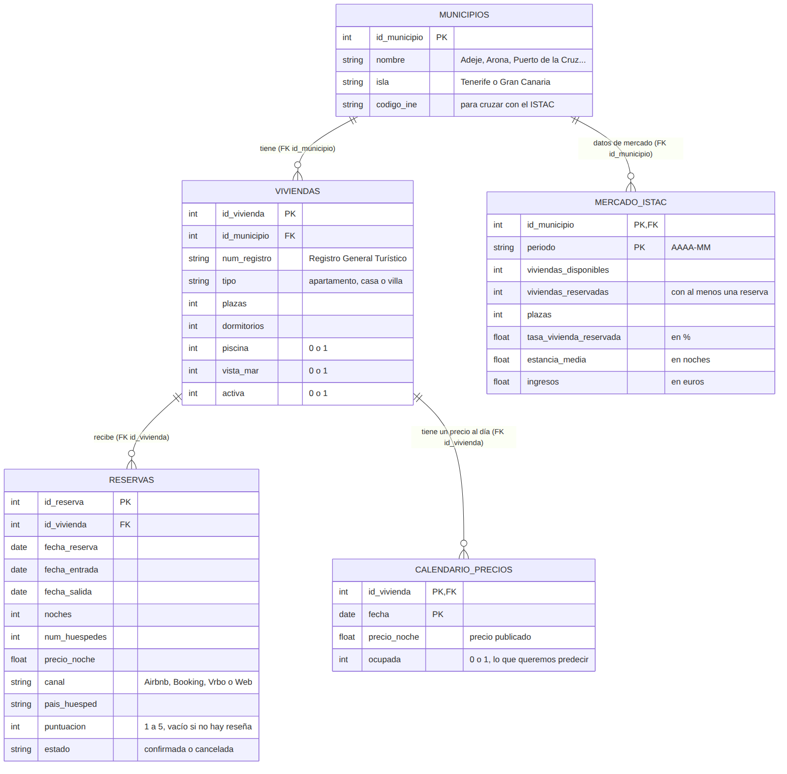
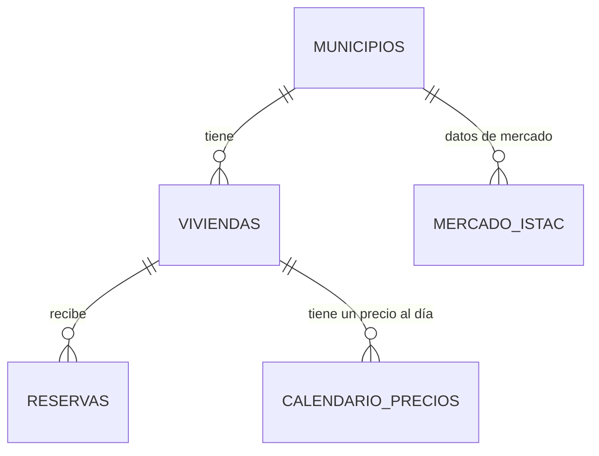

# Fase 2: Cliente y modelo de datos

**Startup:** NaitPrais · **Cliente:** Tabaiba Stays Gestión Vacacional, S.L.

> Tabaiba Stays es una **empresa ficticia** creada para este proyecto. Sus cifras son inventadas, pero coherentes con el mercado real de vivienda vacacional en Canarias. Cualquier parecido con una empresa real es casual.

**Índice**
1. Resumen del entregable
2. Ficha del cliente
3. Datos disponibles
4. Diseño de la base de datos
5. Relaciones
6. Diagrama entidad-relación
7. Pendiente para la fase 3

---

## 1. Resumen del entregable

| Pide el entregable | Dónde está |
|---|---|
| Ficha completa del cliente | Apartado 2 |
| Lista de datos disponibles | Apartado 3 |
| Diseño de la base de datos (tablas, campos, claves) | Apartado 4 y `data/schema.sql` (5 tablas) |
| Diagrama de relaciones | Apartados 5 y 6, `docs/ER_diagram.mmd` y `docs/img/er_diagram.png` |

---

## 2. Ficha del cliente

| | |
|---|---|
| **Nombre** | Tabaiba Stays Gestión Vacacional, S.L. (marca comercial: Tabaiba Stays) |
| **Sector** | Turismo. Gestión de viviendas vacacionales |
| **Actividad** | Gestiona viviendas vacacionales de propietarios particulares y pequeñas empresas a cambio de una comisión: las publica en plataformas, fija los precios, atiende a los huéspedes y se encarga de la limpieza y el mantenimiento. |
| **Sede** | Adeje (Tenerife) |
| **Año de fundación** | 2017 |
| **Tamaño** | Microempresa (menos de 10 empleados). Facturación aproximada en 2025: 480.000 € |
| **Número de empleados** | 9 |
| **Número de clientes** | 41 propietarios con 60 viviendas en gestión. Unas 2.100 reservas y 5.800 huéspedes al año |
| **Zona de trabajo** | Tenerife: Adeje (20 viviendas), Arona (16) y Puerto de la Cruz (8). Gran Canaria: San Bartolomé de Tirajana (10) y Mogán (6) |

**Plantilla**

| Puesto | Personas |
|---|---|
| Dirección (socios) | 2 |
| Administración y liquidaciones | 1 |
| Reservas y atención al huésped | 2 |
| Operaciones (entradas, salidas y revisiones) | 2 |
| Mantenimiento | 1 |
| Captación de propietarios | 1 |

La limpieza y la lavandería están subcontratadas a empresas externas.

### Productos o servicios

1. **Gestión integral de viviendas vacacionales** para propietarios: anuncios, precios, reservas, atención al huésped, limpieza y mantenimiento.
2. **Alojamiento** para huéspedes: 60 viviendas de 2 a 8 plazas (apartamentos, casas y villas), vendidas en Airbnb, Booking.com, Vrbo y en su web propia.
3. **Servicios extra** para huéspedes: traslados desde el aeropuerto, entrada temprana y salida tardía.

### Modelo de negocio

- **Comisión del 22 %** sobre el importe de cada reserva (algunos propietarios con varias viviendas tienen un porcentaje menor).
- **Tarifa de limpieza** por estancia, que paga el huésped.
- **Servicios extra**, que se cobran aparte.
- Cada mes, la gestora paga a cada propietario sus ingresos menos la comisión y los gastos (**liquidación mensual**).

En 2025 las reservas gestionadas sumaron unos 1,6 millones de euros. De ahí salen sus ingresos: unos 350.000 € en comisiones y 125.000 € en tarifas de limpieza.

### Procesos principales

1. **Captación de propietarios:** visita a la vivienda, comprobación de que está inscrita en el Registro General Turístico y firma del contrato.
2. **Publicación y precios:** creación de anuncios en las plataformas y fijación de precios.
3. **Gestión de reservas:** a través de un *channel manager* (programa que sincroniza el calendario de todas las plataformas).
4. **Entrada y salida de huéspedes:** entrega de llaves y revisión de la vivienda.
5. **Limpieza y lavandería:** encargadas a proveedores externos después de cada salida.
6. **Mantenimiento e incidencias:** averías, quejas y reparaciones.
7. **Liquidación mensual** a cada propietario.
8. **Atención al huésped y reseñas.**

### Situación actual

- **Los precios los fija uno de los socios en una hoja de Excel.** Cada vivienda tiene tres tarifas: alta (noviembre a abril), media (julio y agosto) y baja (mayo, junio, septiembre y octubre). Se revisan dos veces al año.
- **Los datos están repartidos:** reservas y calendario en el *channel manager* (se pueden exportar a CSV), precios en Excel, incidencias en un grupo de WhatsApp y un Excel, y liquidaciones en el programa de contabilidad.
- **La empresa no puede crecer con viviendas nuevas.** Desde la entrada en vigor de la Ley 6/2025 (diciembre de 2025), las nuevas altas de viviendas vacacionales están muy limitadas. Para crecer, solo puede captar viviendas que ya estén registradas o ganar más con las que ya gestiona.
- **La competencia entre gestoras ha aumentado:** los propietarios comparan lo que ganan con lo que ganan sus vecinos con otras gestoras.

### Problemas

1. **Precios poco flexibles.** Una vivienda cuesta lo mismo un martes de octubre que en una semana de mucha demanda, porque solo hay tres tarifas al año.
2. **Ocupación desigual.** Las viviendas grandes (6 a 8 plazas) tienen poca ocupación en temporada baja, mientras que las pequeñas se llenan en invierno con mucha antelación, lo que indica que su precio podría ser más alto.
3. **No saben cómo está cada vivienda frente al mercado.** No comparan su ocupación ni sus precios con los de su municipio.
4. **Pérdida de propietarios.** En 2025, 3 propietarios con 4 viviendas se marcharon a otra gestora porque creían que ganarían más. Con la nueva ley, cada vivienda perdida es muy difícil de sustituir.
5. **Mucho trabajo manual.** El socio que fija los precios dedica unas 6 horas a la semana a revisarlos.
6. **Mala planificación de la limpieza.** Sin previsión de ocupación, los proveedores de limpieza se avisan con poca antelación y en temporada alta hay retrasos.

### Necesidades

1. Un **precio recomendado** para cada vivienda y mes, basado en datos y no en intuición.
2. Una **previsión de ocupación** para planificar la limpieza y el personal.
3. Una **comparación con el mercado** de cada municipio usando datos oficiales.
4. **Informes claros** para explicar a cada propietario cómo va su vivienda y así evitar que se marche.
5. **Tener los datos juntos** en un solo sitio, en lugar de en varios programas y hojas de cálculo.

---

## 3. Datos disponibles

**Datos que genera Tabaiba Stays con su actividad**

La empresa produce mucha información, pero la base de datos se centra en el problema que vamos a resolver: **los precios y la ocupación**. El resto se deja fuera para que el diseño sea sencillo.

| Dato | Qué contiene | De dónde sale | ¿Entra en la base de datos? |
|---|---|---|---|
| Viviendas (productos) | Municipio, número de registro, tipo, plazas, piscina, vistas | Contratos y anuncios | Sí → tabla `viviendas` |
| Reservas (ventas) | Fechas, noches, huéspedes, precio, estado | *Channel manager* | Sí → tabla `reservas` |
| Canales de venta | Airbnb, Booking.com, Vrbo o web propia | *Channel manager* | Sí → campo `canal` de `reservas` |
| Huéspedes (clientes finales) | País | *Channel manager* | Sí → campo `pais_huesped` de `reservas` |
| Reseñas | Puntuación de 1 a 5 | Plataformas | Sí → campo `puntuacion` de `reservas` |
| Calendario de precios | Precio publicado cada día y si la noche estaba ocupada | *Channel manager* y Excel de precios | Sí → tabla `calendario_precios` |
| Propietarios | Datos del contrato y comisión | Contratos | No: no hacen falta para recomendar precios |
| Liquidaciones y facturas | Pagos a propietarios y facturas | Programa de contabilidad | No: se pueden calcular a partir de las reservas |
| Empleados y proveedores | Plantilla y empresas de limpieza y mantenimiento | Nóminas y contratos | No: no influyen en el precio |
| Incidencias | Averías y quejas | WhatsApp y Excel | No: se podría añadir más adelante |
| Inventario, visitas a anuncios, campañas | Varios | Excel y plataformas | No: no son útiles para este problema |
| Sensores | - | - | No: las viviendas no tienen sensores |

**Datos externos (públicos)**

| Dato | Qué contiene | Fuente | ¿Entra en la base de datos? |
|---|---|---|---|
| Mercado por municipio | Viviendas disponibles y reservadas, plazas, tasa de vivienda reservada, estancia media e ingresos por mes | ISTAC | Sí → tabla `mercado_istac` |
| Tarifas medias por tamaño de vivienda | Tarifa media según el número de plazas | ISTAC | Pendiente: se decidirá en la fase 3, al ver cómo vienen los datos |
| Registro de viviendas | Viviendas vacacionales inscritas en Canarias | Registro General Turístico (datos abiertos del Gobierno de Canarias) | No como tabla: se usa para comprobar el número de registro y medir la competencia |

---

## 4. Diseño de la base de datos

### Decisiones de diseño

- **Solo 5 tablas**, centradas en precios y ocupación, que es el problema que resuelve NaitPrais.
- **SQLite:** la base de datos es un solo archivo, no necesita servidor y se puede subir al repositorio.
- **Fechas guardadas como texto** con formato `AAAA-MM-DD` (o `AAAA-MM` para meses), porque SQLite no tiene un tipo de dato de fecha. En el diagrama aparecen como `date` para que se entienda mejor.
- **Canal, país y puntuación como campos de `reservas`**, en lugar de tablas aparte, porque cada reserva tiene un solo valor de cada uno.
- **Tabla `calendario_precios`:** guarda el precio de **todas** las noches, se vendieran o no. Con solo las reservas sabríamos a qué precio se vendieron las noches ocupadas, pero no a qué precio estaban las que se quedaron vacías, y no podríamos estudiar cómo afecta el precio a la ocupación. El campo `ocupada` es lo que queremos predecir.
- **Del huésped solo se guarda el país**, sin nombres ni documentos, para cumplir el RGPD (protección de datos).
- **Los datos del ISTAC se unen con los de la empresa** a través del municipio.

### Tablas

**`municipios`**: municipios donde trabaja la empresa (5 filas).

| Campo | Tipo | Clave | Descripción |
|---|---|---|---|
| id_municipio | int | PK | Identificador |
| nombre | string | | Nombre del municipio |
| isla | string | | Tenerife o Gran Canaria |
| codigo_ine | string | | Código oficial, para cruzar con el ISTAC |

**`viviendas`**: viviendas gestionadas (unas 64, incluidas las que ya no están activas).

| Campo | Tipo | Clave | Descripción |
|---|---|---|---|
| id_vivienda | int | PK | Identificador |
| id_municipio | int | FK → municipios | Dónde está |
| num_registro | string | | Número del Registro General Turístico |
| tipo | string | | Apartamento, casa o villa |
| plazas | int | | Número máximo de huéspedes |
| dormitorios | int | | Número de dormitorios |
| piscina | int | | 1 = sí, 0 = no |
| vista_mar | int | | 1 = sí, 0 = no |
| activa | int | | 1 = se gestiona actualmente |

**`reservas`**: reservas de los huéspedes (unas 5.300 en el periodo simulado).

| Campo | Tipo | Clave | Descripción |
|---|---|---|---|
| id_reserva | int | PK | Identificador |
| id_vivienda | int | FK → viviendas | Vivienda reservada |
| fecha_reserva | date | | Día en que se hizo la reserva |
| fecha_entrada | date | | Día de llegada |
| fecha_salida | date | | Día de salida |
| noches | int | | Número de noches |
| num_huespedes | int | | Personas alojadas |
| precio_noche | float | | Precio por noche (€) |
| canal | string | | Airbnb, Booking, Vrbo o Web |
| pais_huesped | string | | País del huésped |
| puntuacion | int | | Reseña de 1 a 5 (vacío si no dejó reseña) |
| estado | string | | Confirmada o cancelada |

**`calendario_precios`**: precio de cada vivienda cada día (unas 60.000 filas).

| Campo | Tipo | Clave | Descripción |
|---|---|---|---|
| id_vivienda | int | PK y FK → viviendas | Vivienda |
| fecha | date | PK | Día |
| precio_noche | float | | Precio publicado ese día (€) |
| ocupada | int | | 1 = ocupada, 0 = libre. **Es lo que queremos predecir** |

La clave primaria está formada por dos campos (`id_vivienda` + `fecha`), porque cada vivienda tiene un solo precio por día.

**`mercado_istac`**: datos oficiales del ISTAC por municipio y mes (desde 2019, unas 450 filas).

> El ISTAC no publica la ocupación por noches, sino la **tasa de vivienda reservada**: el porcentaje de viviendas que tuvieron al menos una reserva en el mes. No es comparable con el campo `ocupada` de la gestora. Para comparar con el mercado usaremos los **ingresos por vivienda disponible** (`ingresos / viviendas_disponibles`) y la **estancia media**.

| Campo | Tipo | Clave | Descripción |
|---|---|---|---|
| id_municipio | int | PK y FK → municipios | Municipio |
| periodo | string | PK | Mes (`AAAA-MM`) |
| viviendas_disponibles | int | | Viviendas vacacionales disponibles |
| viviendas_reservadas | int | | Viviendas con al menos una reserva en el mes |
| plazas | int | | Plazas disponibles |
| tasa_vivienda_reservada | float | | Porcentaje de viviendas disponibles que tuvieron alguna reserva (%) |
| estancia_media | float | | Noches por estancia |
| ingresos | float | | Ingresos del municipio (€) |

El código para crear las tablas está en [`data/schema.sql`](../data/schema.sql).

---

## 5. Relaciones

| Relación | Tipo | Explicación |
|---|---|---|
| municipios → viviendas | 1 a N | Un municipio tiene varias viviendas; cada vivienda está en un municipio |
| viviendas → reservas | 1 a N | Una vivienda recibe muchas reservas; cada reserva es de una vivienda |
| viviendas → calendario_precios | 1 a N | Una vivienda tiene un precio para cada día |
| municipios → mercado_istac | 1 a N | Cada municipio tiene un registro del ISTAC por mes |

---

## 6. Diagrama entidad-relación

El código del diagrama está en [`ER_diagram.mmd`](ER_diagram.mmd). GitHub también lo muestra aquí:

**Cómo leer las líneas:** el lado con dos rayas (`||`) significa "uno" y el lado con la pata de gallo y el círculo (`o{`) significa "cero o muchos". Por ejemplo, un municipio tiene cero o muchas viviendas, y cada vivienda pertenece a un solo municipio.

---

## 7. Pendiente para la fase 3

- Generar los datos simulados de Tabaiba Stays (enero de 2024 a agosto de 2026) y cargarlos en `data/naitprais.db`.
- Descargar los datos del ISTAC, cargarlos en `mercado_istac` y decidir si se añaden las tarifas medias por tamaño de vivienda.
- Obtener los códigos INE de los 5 municipios.
