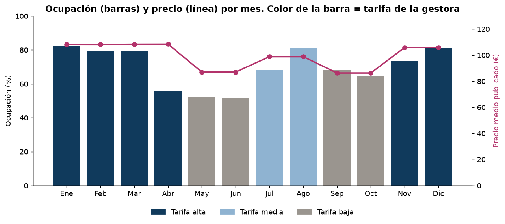
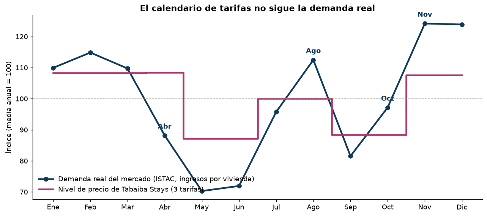
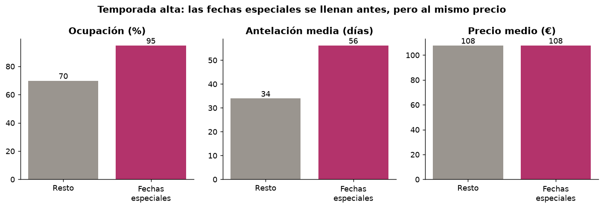
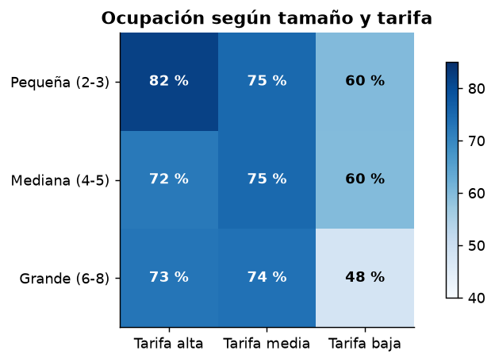
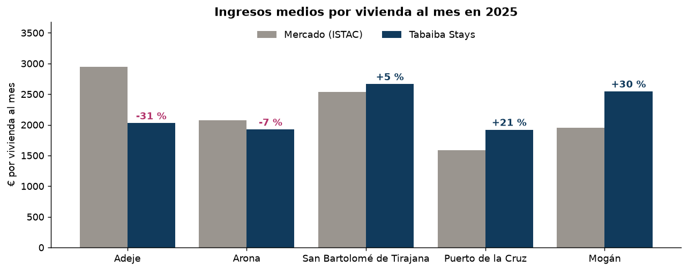
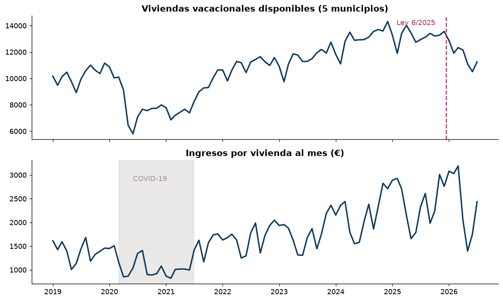
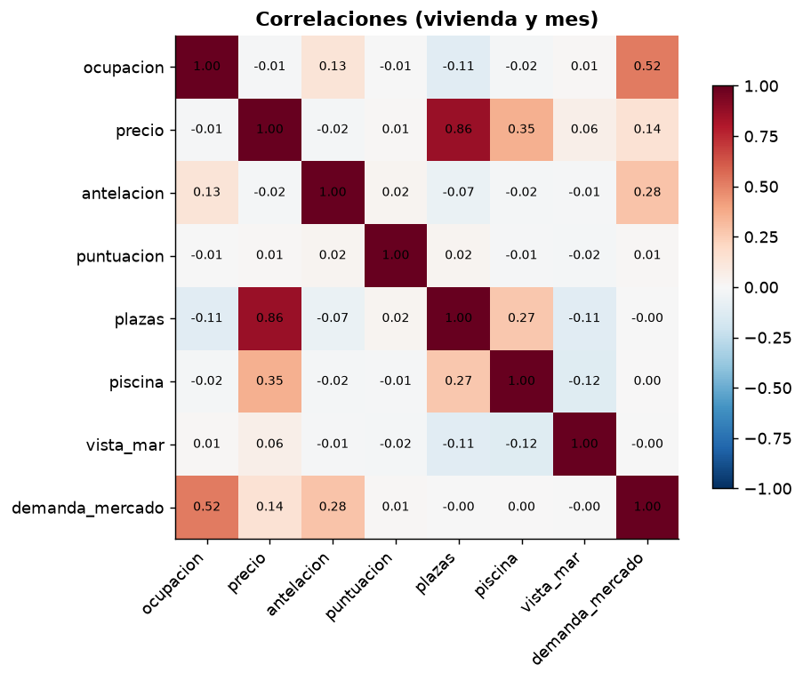
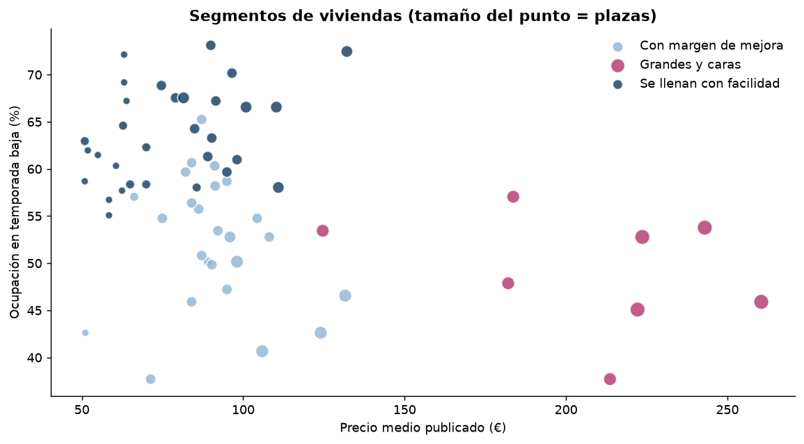
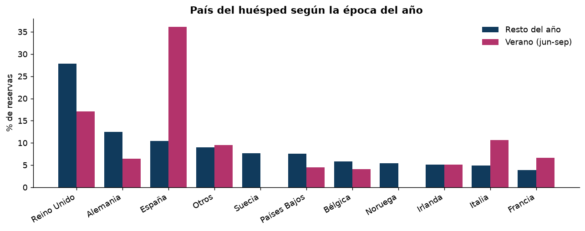

# Fase 4: Análisis exploratorio

**Startup:** NaitPrais · **Cliente:** Tabaiba Stays Gestión Vacacional, S.L. (ficticia)

El análisis completo, con el código y todas las tablas, está en [`notebooks/04_eda.ipynb`](../notebooks/04_eda.ipynb). Este documento resume lo más importante.

**Índice**
1. Resumen del entregable
2. Datos analizados y limpieza
3. Principales descubrimientos
4. Relaciones entre variables
5. Segmentación de viviendas
6. Otros resultados
7. Anomalías
8. Lo que el cliente cree y lo que muestran los datos
9. Tres problemas u oportunidades
10. Problema seleccionado y traducción a ciencia de datos

---

## 1. Resumen del entregable

| Pide el entregable | Dónde está |
|---|---|
| Análisis exploratorio | `notebooks/04_eda.ipynb` |
| Visualizaciones | 9 gráficos en `docs/img/eda_*.png` (los principales, en este documento) |
| Principales conclusiones | Apartados 3 y 8 |
| 3 posibles problemas | Apartado 9 |
| Problema seleccionado | Apartado 10 |
| Cómo abordarlo con ciencia de datos | Apartado 10 |

---

## 2. Datos analizados y limpieza

| Datos | Tipo | Periodo | Filas |
|---|---|---|---|
| Reservas, calendario y viviendas de Tabaiba Stays | Simulados | Enero 2024 - agosto 2026 | 5.331 reservas y 59.930 días |
| Mercado por municipio (ISTAC) | Reales | Enero 2019 - julio 2026 | 455 |

**Limpieza y preparación**
- Fechas convertidas de texto a fecha.
- Sin duplicados, sin precios negativos y sin fechas incoherentes.
- El único campo con vacíos es `puntuacion` (38 %): son reservas sin reseña. No se rellena.
- Las **cancelaciones** (6,7 %) se excluyen de la ocupación, los ingresos y la estancia media.
- **2026 está incompleto**, así que los años se comparan con los mismos meses.
- **ISTAC:** no publica la ocupación por noches, así que comparamos con el mercado usando los **ingresos por vivienda disponible**. En Mogán hay menos de 100 viviendas vacacionales y sus cifras cambian mucho de un mes a otro.
- **Columnas nuevas:** mes, tarifa de la gestora, fechas especiales (Navidad, Carnaval y Semana Santa), antelación de la reserva, tamaño de la vivienda e ingresos del día.

**Cifras generales de 2025:** 1.935 reservas confirmadas, 71,4 % de ocupación, 99,9 € de precio medio, 8,3 noches de estancia media y 33 días de antelación media.

---

## 3. Principales descubrimientos

### 3.1. El precio tiene 3 escalones, pero la ocupación cambia mucho más

- **Abril** se cobra como enero (108 €), pero se ocupa como mayo (56 %).
- **Agosto** se ocupa como diciembre (81 %), pero se cobra con la tarifa media (99 €).

### 3.2. El calendario de tarifas no sigue la demanda real del mercado (datos reales)

Usando los ingresos por vivienda del ISTAC (media 2023-2025) como indicador de demanda, con 100 como mes medio:

| Mes | Demanda real (ISTAC) | Precio de la gestora | Qué pasa |
|---|---|---|---|
| Abril | 88 | 108 | Se cobra como temporada alta, pero es un mes flojo |
| Mayo y junio | 70-72 | 87 | Precio por encima de la demanda |
| Agosto | 112 | 100 | Mes fuerte cobrado como temporada media |
| Octubre | 97 | 88 | Se cobra como temporada baja, pero se parece a julio |
| Noviembre y diciembre | 124 | 108 | Los meses más fuertes, cobrados igual que abril |

### 3.3. Las fechas especiales se venden pronto y al precio de siempre

En Navidad, Carnaval y Semana Santa la ocupación sube del 70 % al **95 %** y las reservas llegan con **56 días** de antelación (frente a 34), pero el precio es el mismo: **108 €**. Una fecha que se vende tan pronto indica que su precio es bajo.

### 3.4. Las viviendas grandes se vacían en temporada baja

Las viviendas de 6 a 8 plazas bajan al **48 %** de ocupación en temporada baja, frente al 60 % del resto.

### 3.5. En Adeje, la gestora ingresa un 31 % menos que el mercado (datos reales)

| Municipio | Viviendas de la gestora | Gestora (€/vivienda/mes) | Mercado (€/vivienda/mes) | Diferencia |
|---|---|---|---|---|
| Adeje | 20 | 2.027 | 2.946 | **-31 %** |
| Arona | 16 | 1.924 | 2.078 | -7 % |
| San Bartolomé de Tirajana | 10 | 2.664 | 2.533 | +5 % |
| Puerto de la Cruz | 8 | 1.921 | 1.585 | +21 % |
| Mogán | 6 | 2.546 | 1.956 | +30 % |

Adeje es la zona con más viviendas de la gestora y el mercado más caro de los cinco, pero la gestora la trata casi como Arona. Es una comparación orientativa: el mercado mezcla viviendas de todos los tamaños.

### 3.6. Hay menos viviendas en el mercado, pero cada una ingresa más (datos reales)

- Desde abril de 2026 hay **entre un 13 % y un 18 % menos de viviendas disponibles** que un año antes en los 5 municipios, después de la entrada en vigor de la Ley 6/2025. No podemos afirmar que la ley sea la única causa.
- De enero a julio de 2026, las viviendas disponibles bajan un 10,4 % y los ingresos totales un 6,3 %, pero **los ingresos por vivienda suben un 4,6 %**.
- Con menos competencia y la demanda aguantando, hay margen para ajustar precios al alza.

---

## 4. Relaciones entre variables

- La ocupación depende sobre todo de la **demanda real del mercado** en ese mes (correlación de 0,52) y algo de la antelación.
- El precio casi no se relaciona con la ocupación (-0,01). **Eso no significa que el precio no importe**: la gestora casi no cambia sus precios y estos dependen sobre todo del tamaño de la vivienda. Con tan poca variación, los datos no permiten medir bien su efecto.

---

## 5. Segmentación de viviendas

Agrupación con K-Means (3 grupos) según ocupación en temporada alta y baja, precio medio y antelación.

| Segmento | Viviendas | Plazas medias | Precio medio | Ocupación alta | Ocupación baja |
|---|---|---|---|---|---|
| Se llenan con facilidad | 31 | 3,3 | 78 € | 80 % | 64 % |
| Con margen de mejora | 25 | 4,2 | 91 € | 69 % | 52 % |
| Grandes y caras | 8 | 7,0 | 207 € | 75 % | 49 % |

- **Se llenan con facilidad:** probablemente tienen el precio bajo en temporada alta.
- **Con margen de mejora:** se ocupan menos incluso en invierno. Hay que revisar su precio y su anuncio.
- **Grandes y caras:** necesitan otro precio fuera del invierno.

---

## 6. Otros resultados

- **Huéspedes:** en verano los españoles pasan del 10 % al 36 % de las reservas y casi desaparecen los nórdicos. Los precios y anuncios de verano deberían pensarse para otro tipo de cliente.
- **Canales:** Airbnb (44 %), Booking (34 %), web propia (14 %) y Vrbo (9 %) tienen cancelaciones y notas parecidas. El problema no está en los canales.
- **Reseñas:** nota media de 4,45 sobre 5. Baja un poco en temporada baja, pero la diferencia es pequeña.

---

## 7. Anomalías

- **133 meses de vivienda por encima del 95 %** de ocupación (precio probablemente bajo) y **106 por debajo del 30 %**. Los casi vacíos se concentran en los segmentos *con margen de mejora* (8 % de sus meses) y *grandes y caras* (6 %).
- **Precios atípicos:** todos los precios por encima de 158 € son de villas. No son errores, son otro producto, y por eso se analizan como segmento aparte.
- **Estancia media:** la gestora tiene estancias de 8,3 noches, frente a 4,8 del mercado. Puede deberse al cliente de invierno de estancia larga, pero también es un **límite de nuestra simulación** que conviene corregir con la estancia real del ISTAC.
- **Datos reales:** la caída por la COVID-19 (2020-2021) y la bajada de viviendas disponibles desde abril de 2026.

---

## 8. Lo que el cliente cree y lo que muestran los datos

| El cliente cree | Los datos muestran |
|---|---|
| "Nuestro problema es la temporada baja; en invierno va todo bien." | En invierno también se pierde dinero: las fechas especiales se llenan al 95 % con casi dos meses de antelación **al precio de siempre**. |
| "Nuestras tres tarifas siguen las temporadas." | Según los datos reales del ISTAC, **abril** es más flojo de lo que se cobra, y **agosto, octubre, noviembre y diciembre**, más fuertes. |
| "Estamos en línea con el mercado." | En **Adeje**, su zona principal, cada vivienda ingresa un **31 % menos** que la media del municipio. |
| "Con la nueva ley el mercado se complica." | Hay menos viviendas, pero los ingresos por vivienda del mercado **siguen subiendo**. |

---

## 9. Tres problemas u oportunidades

| | Problema u oportunidad | Evidencia | Impacto |
|---|---|---|---|
| 1 | **Precios que no siguen a la demanda** | 3 tarifas mal repartidas frente a la demanda real; mismo precio en fechas especiales | Ingresos perdidos en meses fuertes y reservas perdidas en meses flojos |
| 2 | **Viviendas grandes vacías en temporada baja** | 48 % de ocupación con precios de más de 200 € | Noches vacías en las viviendas que más ingresan por noche |
| 3 | **Adeje por debajo del mercado** | -31 % de ingresos por vivienda frente al ISTAC | Menos ingresos y riesgo de que los propietarios se vayan a otra gestora |

---

## 10. Problema seleccionado y traducción a ciencia de datos

**Problema seleccionado: el precio no se adapta a la demanda** (problema 1). Incluye en parte los otros dos, porque las viviendas grandes y Adeje son casos concretos de precios mal ajustados.

| | |
|---|---|
| **Problema empresarial** | Perdemos ingresos porque ponemos el mismo precio en momentos con demanda muy distinta. |
| **Problema de datos** | Predecir la **ocupación esperada** de cada vivienda en cada mes (y en las fechas especiales) según su precio, sus características, la época y la demanda real del mercado, y recomendar el **precio que maximiza los ingresos esperados** (precio × ocupación). |
| **Tipo de problema** | Aprendizaje supervisado (predecir si una noche se reserva o qué ocupación tendrá un mes) más una optimización sencilla del precio. |
| **Variable objetivo** | `ocupada` de `calendario_precios` (o la ocupación mensual de cada vivienda). |
| **Variables de entrada** | Precio publicado, mes, fecha especial, plazas, tipo, piscina, vistas al mar, municipio, demanda del mercado (ISTAC) y antelación histórica. |
| **Validación** | Entrenar con 2024-2025 y comprobar con 2026, meses que el modelo no ha visto. |
| **Cómo mediremos si funciona** | Error de la predicción de ocupación e ingresos esperados con el precio recomendado frente al precio actual. |
| **Resultado para el cliente** | Un rango de precio por vivienda y mes, con el motivo de cada cambio (demanda del mercado, fecha especial, segmento). |

**Limitación importante:** la gestora casi no ha cambiado sus precios, así que el efecto del precio sobre la ocupación se mide con poca precisión. Para compensarlo:
- se usa la variación entre viviendas y entre años;
- las recomendaciones se limitan a cambios moderados (por ejemplo, hasta un ±20 %);
- se propone aplicarlas de forma gradual y medir el resultado, por ejemplo subiendo el precio en la mitad de las viviendas pequeñas en Carnaval y comparando con la otra mitad.
