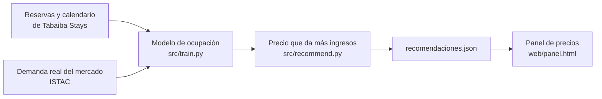
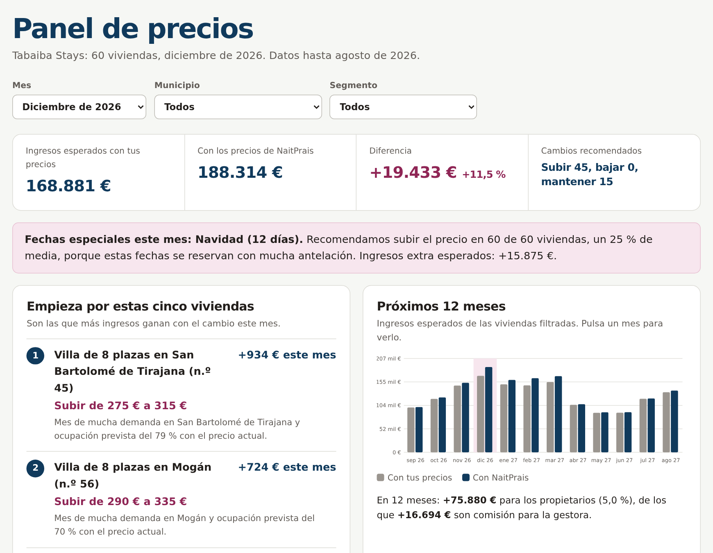
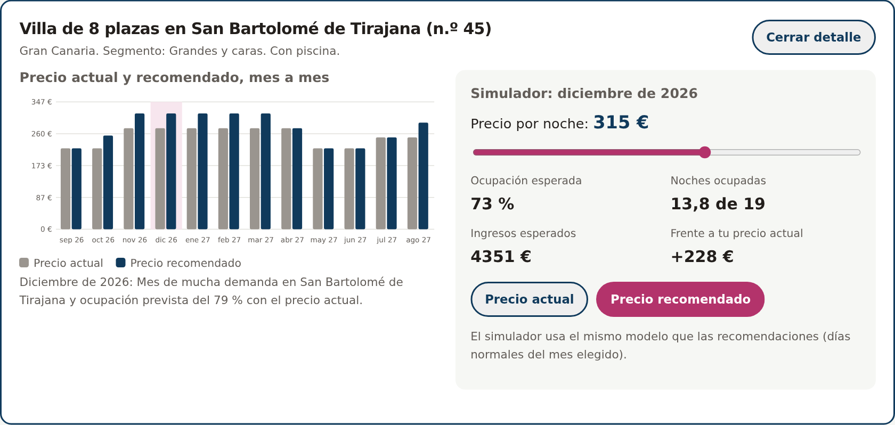

# Fase 5: Solución y prototipo

**Startup:** NaitPrais · **Cliente:** Tabaiba Stays Gestión Vacacional, S.L. (ficticia)

**Índice**
1. Resumen del entregable
2. Qué hemos construido
3. Técnica elegida
4. Evaluación del modelo
5. Del modelo a la recomendación de precio
6. Resultados para Tabaiba Stays
7. El producto: panel de precios
8. Cómo lo usa el cliente
9. Valor para el cliente
10. Limitaciones y siguientes pasos
11. Cómo ejecutarlo

---

## 1. Resumen del entregable

| Pide el entregable | Dónde está |
|---|---|
| Website | `web/index.html` (fase 3) |
| Cliente | `docs/02_datos_cliente.md` |
| Base de datos | `data/naitprais.db` y `data/schema.sql` |
| Datos | `src/generate_data.py`, `src/fetch_istac.py` y `docs/03_datos_web.md` |
| Análisis | `notebooks/04_eda.ipynb` y `docs/04_analisis.md` |
| Solución | `src/features.py`, `src/train.py`, `src/recommend.py` y `models/` |
| Prototipo | Panel de precios: `web/panel.html` |
| Presentación | Presentación de la reunión con el cliente (apartado 11) |

---

## 2. Qué hemos construido

Un **sistema de recomendación de precios** con un panel web que usa la gestora cada mes.



1. **Predicción:** un modelo estima la probabilidad de que cada noche esté ocupada.
2. **Optimización:** para cada vivienda y mes, prueba varios precios y elige el que deja más ingresos esperados.
3. **Producto:** un panel web con las recomendaciones, un ranking de prioridades y un simulador de precios.

No entregamos "el modelo acierta un X %". Entregamos **qué precio poner, a qué viviendas primero y por qué**.

---

## 3. Técnica elegida

**Predicción con regresión logística + optimización del precio.**

| Pregunta | Respuesta |
|---|---|
| ¿Qué predice? | Si una noche estará ocupada (1) o libre (0). La media de un mes es la ocupación esperada. |
| ¿Por qué este modelo? | Es **interpretable** (cada variable tiene un efecto que se puede explicar al cliente) y su fórmula es tan sencilla que el **simulador de la web** la calcula en el navegador. |
| ¿Con qué datos? | 59.930 noches (64 viviendas, enero 2024 - agosto 2026). |

**Variables del modelo** (`src/features.py`)

| Variable | Qué representa | Origen |
|---|---|---|
| `log_precio_rel` | Precio publicado frente al precio medio de la vivienda | Calendario de precios |
| `log_demanda` | Demanda real del municipio en ese mes (ingresos por vivienda, índice) | ISTAC (real) |
| `evento` | Navidad, Carnaval o Semana Santa | Calendario |
| `grande_x_demanda` | Las viviendas grandes dependen más de la demanda | Descubrimiento del EDA |
| `pequena_invierno` | Las viviendas pequeñas se llenan más en invierno | Descubrimiento del EDA |
| Una variable por vivienda | Lo que hace distinta a cada una (ubicación, anuncio, calidad) | Viviendas |

**Efectos estimados (modelo final):** la demanda del mercado (+2,24) y las fechas especiales (+1,99) son lo que más sube la probabilidad de ocupación. El precio la baja (-1,30).

---

## 4. Evaluación del modelo

Entrenado con 2024-2025 y probado con **enero-agosto de 2026**, meses que el modelo no había visto (`models/metricas.json`).

| Métrica | Resultado |
|---|---|
| AUC por noche | 0,70 |
| Error medio de la ocupación mensual de cada vivienda | **13,4 puntos** |
| Error si se repite la ocupación de años anteriores (referencia) | 15,3 puntos |
| Mejora frente a la referencia | **12,4 %** |
| Ocupación real frente a la predicha (2026) | 69,7 % frente a 65,8 % |

- El modelo mejora a la forma actual de estimar la ocupación, pero con un error apreciable: la ocupación de una vivienda en un mes tiene mucho azar (unas pocas reservas cambian mucho el porcentaje).
- Predice una ocupación algo más baja que la real, así que los ingresos esperados del panel son **prudentes**.

---

## 5. Del modelo a la recomendación de precio

Para cada una de las 60 viviendas activas y cada mes de **septiembre de 2026 a agosto de 2027** (`src/recommend.py`):

1. Se parte del **precio actual** (la tarifa de 2026 de la gestora para ese mes).
2. Se prueban precios entre **-15 % y +15 %** (hasta **+25 %** en fechas especiales), redondeados a 5 €.
3. El modelo calcula la ocupación esperada de cada precio.
4. Se elige el precio con **más ingresos esperados** (precio × ocupación × días). La gestora cobra un porcentaje de los ingresos, así que es su objetivo.
5. Si la mejora es menor del 2 %, se **mantiene** el precio para no cambiarlo sin motivo.
6. Cada recomendación lleva un **motivo** en lenguaje sencillo.

Los días normales y las fechas especiales se recomiendan por separado: 960 recomendaciones en total.

### La decisión más importante: el efecto del precio

El histórico casi no tiene cambios de precio (3 tarifas al año) y los precios altos coinciden con los meses de más demanda. Por eso el modelo **subestima** cuánto baja la ocupación al subir el precio: estima -1,30 (intervalo del 90 % por bootstrap: de -1,70 a -1,11). Si usáramos ese valor, el sistema recomendaría subir casi todo.

Por prudencia usamos un **efecto más fuerte (-2,5)** y comprobamos cómo cambia el resultado con otros valores:

| Efecto del precio | Mejora de ingresos (12 meses) | Subir | Mantener | Bajar |
|---|---|---|---|---|
| -1,3 (estimado por el modelo) | +10,5 % | 958 | 2 | 0 |
| -2,0 | +6,8 % | 750 | 202 | 8 |
| **-2,5 (usado)** | **+5,0 %** | **520** | **380** | **60** |
| -3,5 | +4,6 % | 288 | 401 | 271 |

Con cualquiera de estos valores la mejora es positiva (entre +4,6 % y +10,5 %). Con el valor usado damos la cifra baja y recomendaciones equilibradas.

---

## 6. Resultados para Tabaiba Stays

**Próximos 12 meses (septiembre 2026 - agosto 2027)**

| | Con los precios actuales | Con NaitPrais | Diferencia |
|---|---|---|---|
| Ingresos esperados | 1.516.600 € | 1.592.500 € | **+75.900 € (+5,0 %)** |
| Comisión de la gestora (22 %) | | | **+16.700 €** |

**Dónde está la mejora**

| Mes | Mejora | Por qué |
|---|---|---|
| Diciembre 2026 | +19.400 € (+12 %) | Navidad y el mes de más demanda |
| Febrero 2027 | +15.800 € (+11 %) | Carnaval |
| Marzo 2027 | +13.100 € (+8 %) | Semana Santa y demanda alta |
| Enero 2027 | +9.800 € (+7 %) | Final de Navidad y demanda alta |
| Abril a julio 2027 | +700 a 1.300 € al mes | Pocos cambios; en abril, mayo y junio se recomienda **bajar** el precio de entre 15 y 21 viviendas cada mes |

**Qué recomienda:** subir en las fechas especiales y en los meses fuertes (de octubre a marzo y en agosto) y bajar en algunas viviendas en abril, mayo y junio. Coincide con lo que encontramos en el análisis con datos reales del ISTAC.

**Las cinco primeras de diciembre de 2026**

| | Vivienda | Recomendación (días normales) | Ingresos extra del mes |
|---|---|---|---|
| 1 | Villa de 8 plazas en San Bartolomé de Tirajana | Subir de 275 € a 315 € | +934 € |
| 2 | Villa de 8 plazas en Mogán | Subir de 290 € a 335 € | +724 € |
| 3 | Villa de 8 plazas en San Bartolomé de Tirajana | Subir de 250 € a 290 € | +703 € |
| 4 | Villa de 6 plazas en Arona | Subir de 205 € a 235 € | +651 € |
| 5 | Casa de 5 plazas en Mogán | Subir de 150 € a 175 € | +548 € |

---

## 7. El producto: panel de precios

`web/panel.html`, publicado en Vercel junto con la web. Se abre desde el menú de la web ("Panel de clientes").



**Qué incluye**
- **Filtros** por mes, municipio y segmento (los del EDA).
- **Resumen del mes:** ingresos esperados con los precios actuales y con NaitPrais, diferencia y número de cambios.
- **Aviso de fechas especiales:** cuántas viviendas subir y cuánto.
- **"Empieza por estas cinco viviendas":** ranking de las que más ganan con el cambio, con el motivo.
- **Próximos 12 meses:** gráfico de ingresos esperados; al pulsar un mes, el panel cambia a ese mes.
- **Tabla de todas las viviendas:** precio actual y recomendado, ocupación prevista antes y después, ingresos extra y acción.
- **Detalle de cada vivienda** con un **simulador**: al mover el precio se recalcula la ocupación y los ingresos esperados con el mismo modelo.
- **"Cómo se calculan las recomendaciones":** explicación, error del modelo y tabla de sensibilidad.



---

## 8. Cómo lo usa el cliente

1. **Principio de mes:** la gestora exporta sus reservas y precios del *channel manager* en CSV.
2. NaitPrais actualiza los datos, vuelve a entrenar el modelo y genera las recomendaciones (`src/train.py` y `src/recommend.py`).
3. La gestora abre el panel, empieza por las **cinco viviendas prioritarias** y cambia sus precios en el *channel manager*.
4. Antes de cada fecha especial, el aviso le indica qué viviendas subir y cuánto.
5. Con el simulador responde a preguntas de los propietarios ("¿y si bajo a 90 €?").
6. **Al mes siguiente** se comparan las reservas reales con lo previsto. Así el modelo aprende cómo responde de verdad la demanda a los cambios de precio.

---

## 9. Valor para el cliente

| Para quién | Valor |
|---|---|
| **Propietarios** | Unos **75.900 €** más en 12 meses entre todas las viviendas (+5 %). |
| **Gestora** | Unos **16.700 €** más de comisión al año. |
| **Gestora** | Menos trabajo manual: el socio que revisaba precios unas 6 horas a la semana solo tiene que aplicar las prioridades. |
| **Gestora** | Argumentos para retener propietarios: puede enseñarles por qué su vivienda tiene ese precio y cuánto gana con el cambio. |

**¿Por qué pagaría?** Con una suscripción de, por ejemplo, **15 € por vivienda al mes** (60 viviendas = 10.800 € al año), la gestora recupera la inversión solo con la comisión extra (16.700 €), sin contar el tiempo ahorrado ni los propietarios que no se van.

---

## 10. Limitaciones y siguientes pasos

- **Efecto del precio poco preciso:** el histórico casi no tiene cambios de precio. **Siguiente paso:** aplicar las recomendaciones en la mitad de las viviendas de cada segmento durante unos meses y comparar con la otra mitad. Con esos datos el modelo medirá mejor el efecto del precio.
- **Datos simulados:** los datos del cliente son simulados (ver `08_datos_reales.md`). Con una gestora real habría que sustituir `viviendas`, `reservas` y `calendario_precios`.
- **Error del modelo:** 13 puntos de ocupación mensual. Sirve para decidir la dirección del precio, no para prometer una ocupación exacta.
- **Mejoras posibles:** precio por día de la semana, estancia mínima, reseñas y competencia de cada zona con el Registro General Turístico.

---

## 11. Cómo ejecutarlo

```bash
python src/generate_data.py                           # datos simulados del cliente
python src/fetch_istac.py --archivo data/istac_raw.tsv   # datos reales del ISTAC
python src/check_data.py                              # comprobaciones
python src/train.py                                   # entrena y evalúa el modelo
python src/recommend.py                               # recomendaciones y JSON del panel
```

Para ver la web y el panel en local, desde la carpeta `web`:

```bash
python -m http.server
```

y abrir `http://localhost:8000/panel.html`.
